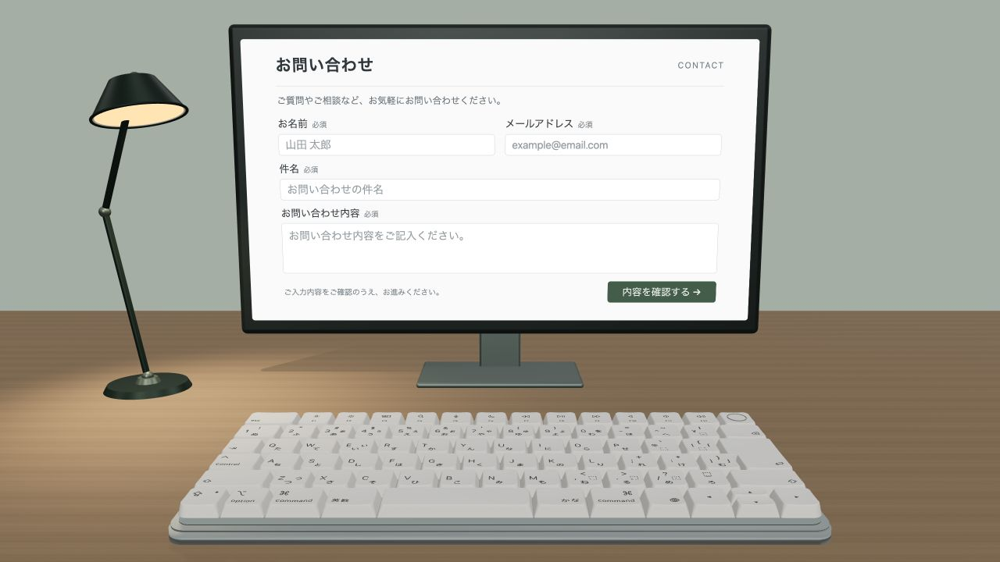

# Magic JIS Contact

机・スタンドライト・モニターを配置した3Dのお問い合わせ画面です。入力した物理キーに合わせて、80キーのMac JISキーボードが動きます。



## 特徴

- 白基調のお問い合わせフォーム（氏名・メールアドレス・件名・本文）
- NuPhy風の滑らかなマット素材と、丸み・くぼみのあるキーキャップ
- キー押下と復帰、複数キー入力、フォーカス離脱時のリセット
- Three.jsによる3D描画とCSS3Dによる入力可能なモニター画面

フォームは画面デザインのみです。入力内容の送信・保存や問い合わせ用バックエンドはありません。

## ローカルで起動

Node.jsとPython 3を使用します。

```sh
npm ci
npm run build
npm run preview
```

ブラウザーで http://127.0.0.1:8777/ を開いてください。

```sh
npm test
```

押下アニメーションの復帰、Spaceの単独動作、入力の重なり、フォーカス離脱を検証します。

## 構成

- `app.js`: シーンとフォーム入力のキー連動
- `key-motion.js`: 押下・復帰アニメーション
- `key-material.js`: キーキャップのマット素材
- `desk-scene.js` / `monitor-scene.js`: 机・ライト・モニター
- `dist/index.html`: フォームのHTML/CSS
- `dist/keyboard.json` / `dist/keyboard.bin`: キーボードの3Dモデル
- `dist/app.js`: ビルド済みJavaScript

`dist/` は静的ホスティングに使用できます。

既存の公開先: https://magic-jis-keyboard.j-ishihara.chatgpt.site/

AppleやNuPhyの公式製品・公式サイトではありません。
